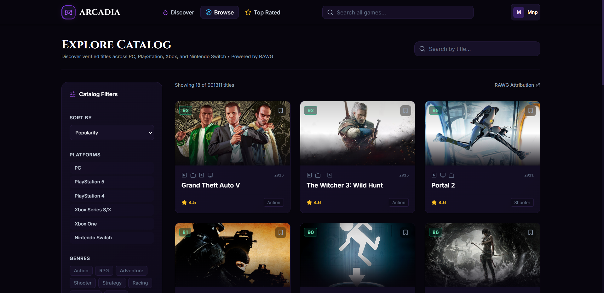
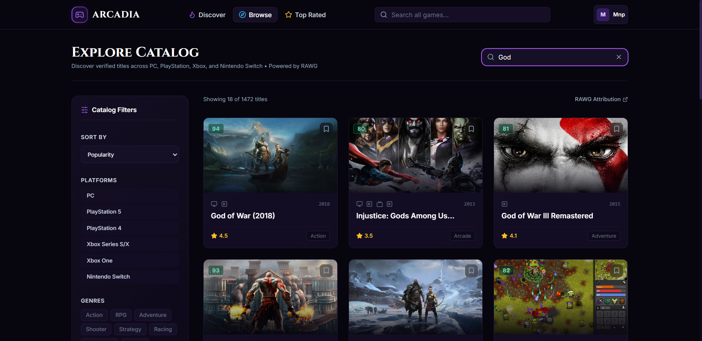
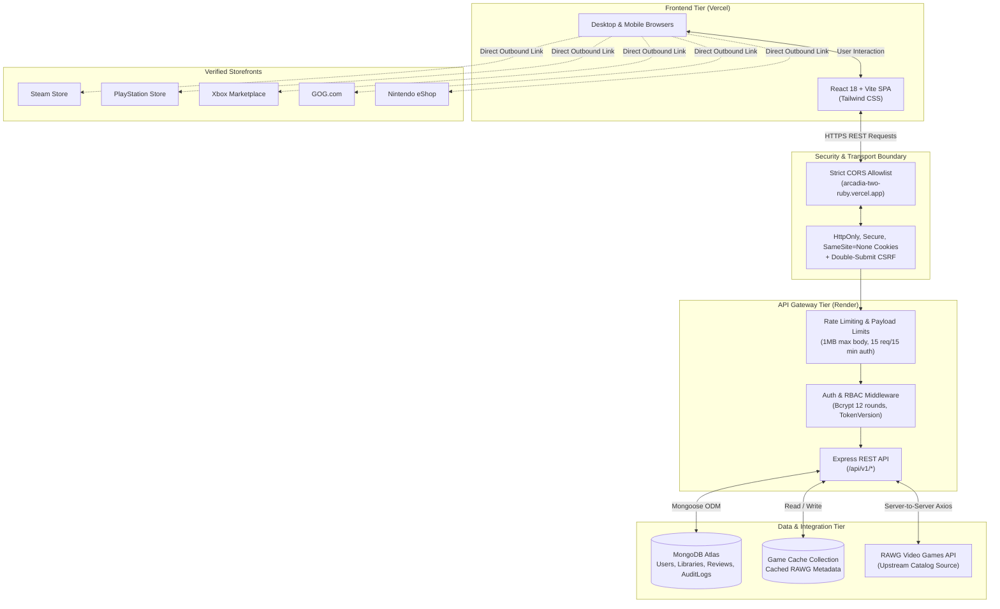

# Arcadia — Digital Game Discovery & Storefront Platform

> A full-stack game discovery and catalog platform engineered with a dark-themed visual aesthetic, multi-platform search, verified external store integrations, and role-based administrative moderation.

---

## 📌 Project Overview

**Arcadia** is an engineering portfolio project that demonstrates a full-stack, production-hardened web application for video game discovery. 

Modern gamers navigate fragmented ecosystems (Steam, PlayStation Store, Xbox, Nintendo eShop, and GOG) with inconsistent metadata, disjointed reviews, and separate libraries. Arcadia unifies discovery across these platforms into a single, high-performance web experience.

**Live Application:** [https://arcadia-two-ruby.vercel.app/](https://arcadia-two-ruby.vercel.app/)

> **Notice:** Arcadia is a portfolio project and catalog discovery engine. It does not process payments or sell games directly. All game acquisitions are routed via verified outbound links to authorized, licensed retailers (Steam, PlayStation Store, Xbox Marketplace, Epic Games, GOG, and Nintendo eShop).

---

## 🖼️ Application Preview

Experience the live deployed platform: **[arcadia-two-ruby.vercel.app](https://arcadia-two-ruby.vercel.app/)**

> **Platform Model:** Arcadia aggregates game data, community reviews, and verified store availability. It is strictly a game discovery platform and does not offer an internal checkout or payment processing system.

### 1. Discover & Featured Hero View
The discovery landing page showcases featured titles with integrated Metacritic benchmark scoring, community rating indicators, genre categorization, and direct links to inspect title details, add to wishlist, or explore curated categories.

### 2. Multi-Platform Catalog Exploration & Filtering
The catalog explorer provides real-time multi-platform filtering across PC, PlayStation 5, PlayStation 4, Xbox Series S/X, Xbox One, and Nintendo Switch, complete with genre categorization, popularity sorting, and responsive game cards.

### 3. Real-Time Title Search & Match Results
The search view queries cached title indexes and upstream catalog databases with instant keyword matching, displaying release year badges, platform compatibility tags, and community ratings.

---

## 🎯 Verified Features

- **Multi-Platform Game Catalog**: Upstream proxy integration with the RAWG Video Games Database API featuring local database caching, Metacritic benchmark scoring, genre filtering, and bounded pagination.
- **Strict Data Ownership & Collection Isolation**:
  - **Personal Libraries**: Track ownership and gameplay progress across four distinct states (*Playing*, *Completed*, *Backlog*, *Dropped*) with platform tagging.
  - **Wishlists**: Isolated bookmarking system preventing artificial overlap with library inventory.
- **Community Reviews & Ratings**: 1-to-5 star rating system with aggregate telemetry, user reviews, and author edit permissions.
- **Administrative Control Plane (`/admin`)**:
  - User account moderation (account suspension and role promotion/demotion).
  - Catalog curation (featured title pinning and cache purging).
  - Review moderation and an immutable administrative audit log stream.
- **Application Security & Hardening**:
  - Strict CORS origin allowlisting blocking arbitrary third-party subdomains and preview spoofing.
  - Fail-safe production administrator bootstrap script enforcing password complexity before database mutation.
  - Cross-origin session cookies (`HttpOnly`, `Secure`, `SameSite=None`) with instant token version revocation.
  - Double-submit Anti-CSRF protection tokens on all mutating HTTP methods.
  - 1MB payload limits intercepting oversized request bodies with HTTP 413 `PAYLOAD_TOO_LARGE`.
- **Verified External Storefront Routing**: Sanitized outbound redirection restricted to verified gaming storefronts, preventing open-redirect exploitation.

---

## 🏗️ Technology Stack

| Technology | Role in Architecture |
| :--- | :--- |
| **React 18** | Client-side user interface, state management, and component architecture |
| **TypeScript 5.7** | End-to-end type safety across shared data models, API endpoints, and UI |
| **Vite** | Modern frontend tooling, code-splitting, and asset bundling |
| **Tailwind CSS** | Custom dark-purple design system with glassmorphic accents and responsive layouts |
| **Node.js & Express** | REST API gateway, authentication middleware, rate limiting, and route guards |
| **MongoDB Atlas & Mongoose** | Persistent document storage for users, personal libraries, reviews, and audit logs |
| **RAWG Video Games Database API** | Upstream video game metadata, artwork, release dates, and platform information |
| **Bcrypt.js** | Salted password hashing using 12 computational rounds |
| **JSON Web Tokens (JWT)** | Stateless authentication tokens stored in secure, HttpOnly browser cookies |
| **Vercel** | Edge hosting and continuous deployment for the frontend Single-Page Application (SPA) |
| **Render** | Cloud web service hosting for the backend Express REST API |

---

## 📐 High-Level Architecture

---

## 🔄 Typical User Workflow

1. **Discovery & Browsing**: The user visits the storefront, browsing trending, top-rated (Metacritic score >= 80), and newly released titles.
2. **Catalog Search & Filtering**: The user enters a search term or filters by genre (Action, RPG, Strategy, Indie) and platform. Requests route through the backend proxy, which serves cached metadata from MongoDB or retrieves fresh data from RAWG.
3. **Game Inspection**: The detail view renders title metadata, screenshots, system requirements, community ratings, and verified store links.
4. **Account Management & Authentication**: The user creates an account or signs in. Passwords are validated using Zod, hashed with 12 bcrypt rounds, and issued as a stateless JWT in an `HttpOnly` cookie.
5. **Collection Tracking**:
   - Clicking **Wishlist** saves the title to the user's isolated bookmark list.
   - Clicking **Add to Library** allows setting the play status (*Playing*, *Completed*, *Backlog*, *Dropped*) and target platform.
6. **Community Review**: The authenticated user posts a review and rating. Duplicate reviews by the same user on the same title are rejected.
7. **External Acquisition**: When ready to purchase or download, the user clicks verified storefront links directing to the official retailer.

---

## 🔍 Showcase Repository Contents

This public showcase repository provides architectural documentation, API contracts, security analysis, and deployment runbooks:

- [System Architecture](docs/ARCHITECTURE.md) — Detailed monorepo topology, package boundaries, and service relationships.
- [System Design & Data Flow](docs/SYSTEM_DESIGN.md) — Authentication lifecycle, session invalidation, and data flow specifications.
- [Sanitized API Reference](docs/API_REFERENCE.md) — Endpoint documentation, request/response formats, and role requirements.
- [Security Engineering Overview](docs/SECURITY_OVERVIEW.md) — Security controls, threat modeling, and vulnerability disclosures.
- [Development & Deployment Runbook](docs/DEVELOPMENT_AND_DEPLOYMENT.md) — Operational architecture, deployment environments, and build pipelines.

---

## ⚠️ Known Limitations & Engineering Roadmap

In the interest of full technical transparency, the following items reflect ongoing engineering backlog items:

1. **Transactional Email Service**: In development mode, password reset tokens are returned in the API payload for testing. In production, an outbound transactional email service (e.g. Resend, SendGrid) is required to deliver reset links to user inboxes.
2. **Upstream Dependency Migrations**:
   - `zod`: Currently on `3.25.76`. Upgrading to `zod@4.x` resolves advisory `GHSA-mrhx-c7xc-m3w5` and is planned as a dedicated refactor across shared schema contracts. (Existing 1MB body limits and scalar schemas mitigate exploitation).
   - `react-router`: Currently on `6.30.6`. Upgrading to `react-router-dom@7.x` resolves advisories `GHSA-wrjc-x8rr-h8h6` and `GHSA-337j-9hxr-rhxg`. (The application's static SPA architecture and strict internal routing prevent exposure).
3. **Search Caching Layer**: Adding Redis in front of the MongoDB catalog cache to further reduce upstream query latency during high-traffic peaks.

---

## 🌱 Project Evolution

Arcadia grew out of an earlier gaming website created using WordPress: **[Gameverse](https://gaminginfo579763741.wordpress.com/home/)**.

That initial project provided hands-on experience in organizing gaming content and presenting video game media. It ultimately inspired a more comprehensive, production-grade game discovery platform in Arcadia—transitioning from a content site into a modern, full-stack application with searchable catalogs, platform and genre filtering, community reviews, personal libraries, and defense-in-depth security architecture.

| Milestone | Project & Role | Architecture |
| :--- | :--- | :--- |
| **Early Exploration** | [Gameverse (WordPress)](https://gaminginfo579763741.wordpress.com/home/) | WordPress, CMS-managed gaming content |
| **Current Platform** | [Arcadia (Live Web App)](https://arcadia-two-ruby.vercel.app/) | React 18, TypeScript, Node.js, Express, MongoDB Atlas, RAWG API |
| **Engineering Docs** | [Showcase Repository](https://github.com/mnp210/Arcadia-showcase) | Architectural specs, threat models, API reference & verification runbooks |

*The two websites are separate projects that represent progressive stages of an engineering journey from content management to full-stack systems design.*

---

## ⚖️ Attribution & Licensing

- **Documentation & Showcase Assets**: Licensed under the [MIT License](LICENSE).
- **Game Metadata & Artwork**: Game titles, logos, screenshots, and metadata are retrieved via the [RAWG API](https://rawg.io) and belong to their respective publishers and developers. Displayed under catalog fair-use and information discovery principles.
- **Icons**: Provided by [Lucide Icons](https://lucide.dev) under the ISC License.

---

*Showcase Repository maintained by [mnp210](https://github.com/mnp210).*
