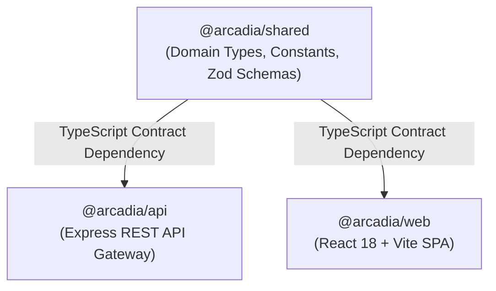
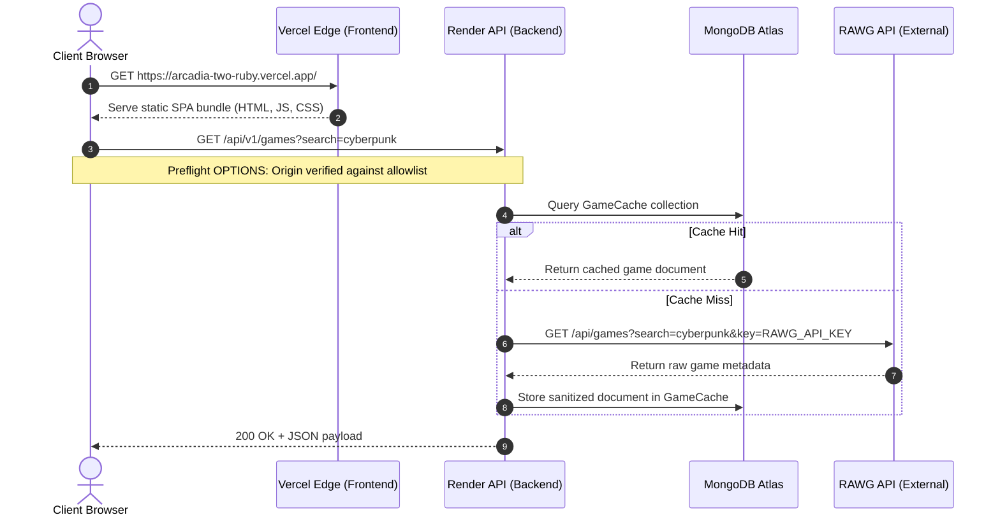

# Arcadia — System Architecture Documentation

[← Back to Showcase Overview](../README.md) • [System Design](SYSTEM_DESIGN.md) • [API Reference](API_REFERENCE.md) • [Security Overview](SECURITY_OVERVIEW.md) • [Deployment Runbook](DEVELOPMENT_AND_DEPLOYMENT.md)

---

This document describes the architectural topology, service boundaries, communication protocols, and monorepo workspace design of the Arcadia platform.

---

## 1. Monorepo Structure & Package Boundaries

Arcadia is architected as a modular TypeScript monorepo managed via npm workspaces. This design ensures strict separation of concerns while sharing domain models, validation contracts, and DTO types across client and server.



### Workspace Directory Layout
```text
Arcadia/
├── packages/
│   └── shared/                 # Core domain types, shared Zod schemas, constants
│       ├── src/
│       │   ├── constants/      # User roles, library statuses, HTTP status codes
│       │   ├── schemas/        # Zod input validation schemas (Register, Login, Review, etc.)
│       │   └── types/          # DTO interfaces, API response envelopes, entity models
│       └── package.json
├── apps/
│   ├── api/                    # Express REST backend service
│   │   ├── src/
│   │   │   ├── config/         # Environment parsing & database connection
│   │   │   ├── controllers/    # Route controllers (Auth, Admin, RAWG, User, Review, etc.)
│   │   │   ├── middleware/     # Helmet, CORS, CSRF, Rate Limiting, RBAC guards
│   │   │   ├── models/         # Mongoose schemas (User, Library, Wishlist, GameCache, Review, AuditLog)
│   │   │   ├── routes/         # Versioned endpoint definitions (/api/v1/*) & health probes
│   │   │   ├── services/       # Domain business logic & external API proxies
│   │   │   └── utils/          # Origin allowlist, AppError, logger
│   │   ├── scripts/            # CLI admin bootstrap utility (seedAdmin.ts)
│   │   └── tests/              # Automated Vitest test suites (121 tests, 8 test suites)
│   └── web/                    # Client-side React SPA
│       ├── src/
│       │   ├── components/     # UI components, layout shells, cards, modals
│       │   ├── context/        # Authentication & theme state providers
│       │   ├── pages/          # Storefront, Catalog, Detail, User, Admin views
│       │   └── services/       # Axios API client instances
│       └── vercel.json         # Security headers & SPA routing rewrites
└── docs/                       # Architectural & security documentation
```

---

## 2. Component Relationships & Responsibilities

### Frontend Application (`@arcadia/web`)
- **Runtime Environment:** Browser-based Single-Page Application (SPA) served via Vercel Edge Network.
- **Key Responsibilities:**
  - Client-side routing with `react-router-dom` declarative navigation.
  - Reactive state management for authentication sessions, personal libraries, and wishlist items.
  - Interactive UI with custom Tailwind CSS styling, responsive grid layouts, and glassmorphic aesthetic.
  - Communicating exclusively with the backend API via credentialed HTTPS requests (`withCredentials: true`).

### Backend API Gateway (`@arcadia/api`)
- **Runtime Environment:** Node.js (v20.x) running an Express application hosted on Render.
- **Key Responsibilities:**
  - Centralized request routing, security middleware execution, and input sanitization.
  - Authenticating sessions using cryptographically verified JSON Web Tokens stored in HTTP-only cookies.
  - Enforcing Role-Based Access Control (RBAC) to protect administrative functions.
  - Proxying and caching upstream requests to the RAWG Video Games Database API.
  - Writing immutable audit logs for sensitive operational events.

### Shared Contracts Library (`@arcadia/shared`)
- **Role:** Pure TypeScript package compiled to JavaScript and declaration files.
- **Key Responsibilities:**
  - Single source of truth for API response envelopes (`ApiResponse<T>`).
  - Shared Zod validation schemas ensuring identical validation rules on the frontend form level and the backend gateway level.
  - Defining strongly-typed DTOs to prevent internal database fields (e.g. `passwordHash`, `tokenVersion`) from escaping into responses.

### Database Tier (MongoDB Atlas)
- **Role:** Managed cloud document database.
- **Collections:**
  - `users`: User identity, credential hashes, roles, and session token versions.
  - `libraries`: User game library entries tracking gameplay statuses (`playing`, `completed`, `backlog`, `dropped`) and platforms.
  - `wishlists`: User wishlist bookmarks with unique index per user and game.
  - `reviews`: Community ratings (1-5 stars), headlines, and review commentary with unique constraint per user and game.
  - `gamecaches`: Cached game metadata from upstream RAWG API calls with automatic TTL management.
  - `auditlogs`: Immutable administrative action logs with timestamps and IP records.

---

## 3. Network & Deployment Boundaries



---

## 4. Key Architectural Trade-offs & Decisions

1. **Server-Side API Proxy vs. Direct Client Calls:**
   - *Decision:* All RAWG game catalog requests route through the Express API proxy rather than having the frontend call RAWG directly.
   - *Rationale:* Protects upstream API credentials from browser inspection, enforces caching in MongoDB to respect rate limits, and normalizes external data into consistent application DTOs.

2. **HttpOnly Cookies vs. LocalStorage for Session Tokens:**
   - *Decision:* Authentication tokens are delivered in `HttpOnly`, `Secure`, `SameSite=None` cookies alongside double-submit Anti-CSRF protection tokens.
   - *Rationale:* Completely prevents client-side JavaScript access to authentication tokens, eliminating token theft via Cross-Site Scripting (XSS).

3. **External Retailer Redirection vs. Mock Checkout:**
   - *Decision:* Users acquire games through verified external links to legitimate storefronts (Steam, PlayStation, Xbox, etc.).
   - *Rationale:* Preserves ethical integrity for a portfolio project by avoiding deceptive checkout simulations while validating external URL destinations against a strict domain allowlist.

---

[← Back to Showcase Overview](../README.md) • [System Design](SYSTEM_DESIGN.md) • [API Reference](API_REFERENCE.md) • [Security Overview](SECURITY_OVERVIEW.md) • [Deployment Runbook](DEVELOPMENT_AND_DEPLOYMENT.md)
