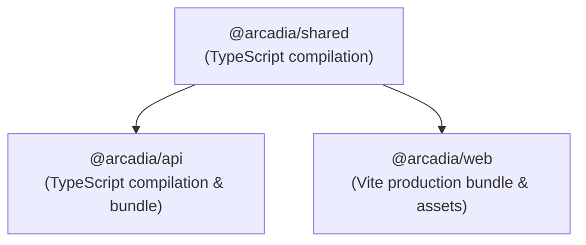
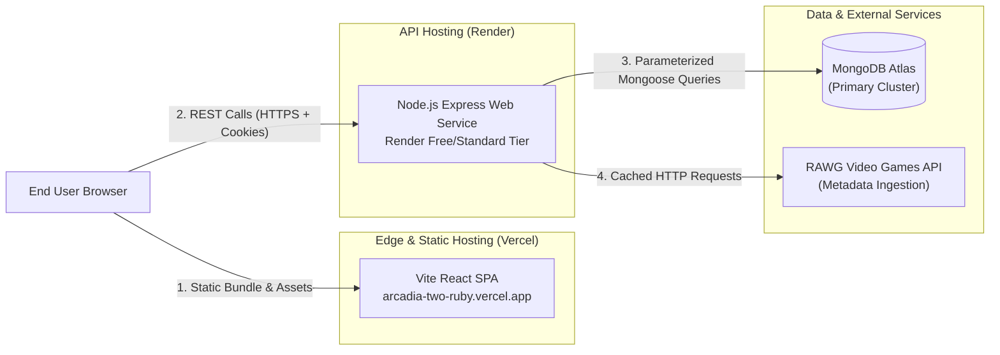

# Arcadia — Development & Deployment Architecture

[← Back to Showcase Overview](../README.md) • [Architecture](ARCHITECTURE.md) • [System Design](SYSTEM_DESIGN.md) • [API Reference](API_REFERENCE.md) • [Security Overview](SECURITY_OVERVIEW.md)

---

This document details the build systems, local development workflows, environment variable configurations, and production deployment topology for the Arcadia monorepo.

---

## 1. Monorepo Architecture & Build Lifecycle

Arcadia is organized as an npm workspaces monorepo containing three core packages:

```
arcadia/
├── packages/
│   └── shared/       # Shared TypeScript schemas, contracts, and interfaces (@arcadia/shared)
└── apps/
    ├── api/          # Express.js REST API service (@arcadia/api)
    └── web/          # React 18 / Vite Single Page Application (@arcadia/web)
```

### Build Dependency Graph



Because `@arcadia/api` and `@arcadia/web` depend on compiled TypeScript declarations from `@arcadia/shared`, compilation must follow a strict topological order.

### Build & Verification Commands

| Command | Target Scope | Description |
| :--- | :--- | :--- |
| `npm run build:shared` | `@arcadia/shared` | Compiles shared types and Zod schemas to `dist/`. |
| `npm run build:api` | `@arcadia/api` | Compiles Express backend server into production artifacts. |
| `npm run build:web` | `@arcadia/web` | Bundles the React frontend into static assets using Vite. |
| `npm run build` | Monorepo Root | Sequentially compiles shared, api, and web packages in topological order. |
| `npm run typecheck` | Monorepo Root | Runs `tsc --noEmit` across all workspaces to enforce zero type errors. |
| `npm run test` | Monorepo Root | Executes unit, integration, and security test suites across all packages. |
| `npm run test --workspace=@arcadia/api` | `@arcadia/api` | Runs API test suites (121 tests across 8 test suites) using Vitest and in-memory MongoDB. |

---

## 2. Environment Configuration

Arcadia enforces strict environment-variable isolation between the client-facing browser bundle and the backend server. Sensitive credentials (database URIs, API secrets, JWT signing keys) are confined strictly to the backend execution context.

### 2.1 Backend API Environment (`apps/api/.env`)

| Variable | Format / Example | Required | Description |
| :--- | :--- | :---: | :--- |
| `NODE_ENV` | `development` \| `production` \| `test` | Yes | Controls logging verbosity, CORS rules, and security flags. |
| `PORT` | `5000` | No | Port on which the Express HTTP server listens (defaults to 5000). |
| `APP_BASE_URL` | `https://arcadia-api.onrender.com` | No | Public base URL of the API gateway (defaults to `http://localhost:5000`). |
| `FRONTEND_ORIGIN` | `https://arcadia-two-ruby.vercel.app` | Yes | Allowed frontend origin(s) for CORS verification (comma-separated if multiple). |
| `MONGODB_URI` | `mongodb+srv://<user>:<password>@cluster.mongodb.net/arcadia` | Yes | MongoDB Atlas connection string with authenticated credentials. |
| `JWT_SECRET` | `min-32-char-random-cryptographic-key` | Yes | High-entropy secret key for signing and verifying JWT tokens. |
| `JWT_EXPIRES_IN` | `7d` | No | Token expiration duration (defaults to `7d`). |
| `COOKIE_NAME` | `arcadia_session` | No | Cookie identifier name for session tokens (defaults to `arcadia_session`). |
| `RAWG_API_KEY` | `your_rawg_api_key_here` | Yes | API key obtained from rawg.io for game metadata indexing. |
| `ADMIN_BOOTSTRAP_EMAIL` | `admin@example.com` | No | Administrator email used for the bootstrap CLI script (`seedAdmin.ts`). Alias: `INITIAL_ADMIN_EMAIL`. |
| `ADMIN_BOOTSTRAP_PASSWORD`| `min-12-char-strong-password` | No | Initial administrator password for bootstrap script. In production, default passwords are rejected. Alias: `INITIAL_ADMIN_PASSWORD`. |
| `ADMIN_BOOTSTRAP_KEY` | `min-32-char-random-key` | No | Secret authorization key for remote bootstrap execution. |
| `GOOGLE_CLIENT_ID` | `oauth-client-id.apps.googleusercontent.com` | No | Optional client ID for enabling Google OAuth sign-in. |
| `GOOGLE_CLIENT_SECRET` | `oauth-client-secret-here` | No | Optional client secret for Google OAuth sign-in. |

> [!CAUTION]
> Never commit actual `.env` files or hardcoded credentials to version control. Production values should be injected strictly via deployment platform secret managers.

### 2.2 Frontend Client Environment (`apps/web/.env`)

| Variable | Format / Example | Required | Description |
| :--- | :--- | :---: | :--- |
| `VITE_API_URL` | `https://arcadia-api.onrender.com/api/v1` | Yes | Public base URL pointing to the deployed Express backend. |

> [!NOTE]
> All variables prefixed with `VITE_` are embedded into the client-side JavaScript bundle during the Vite build step. Never store private API keys or database secrets in the frontend environment.

---

## 3. Production Deployment Topology

Arcadia utilizes a decoupled, serverless-and-container cloud deployment architecture to ensure cost efficiency, scalability, and strict security isolation.



### 3.1 Frontend Deployment: Vercel
- **Hosting Model**: Global Edge Content Delivery Network (CDN).
- **Build Configuration**:
  - Build Command: `npm run build:shared && npm run build:web`
  - Output Directory: `apps/web/dist`
  - Single-Page Application (SPA) rewrites: All client routes redirect to `index.html` via `vercel.json` rewrites.
- **Security Headers**: Edge-level HTTP headers include strict `X-Content-Type-Options: nosniff`, `X-Frame-Options: DENY`, and `Referrer-Policy: strict-origin-when-cross-origin`.

### 3.2 Backend Deployment: Render
- **Hosting Model**: Node.js Web Service running in an isolated Linux container.
- **Build Configuration**:
  - Build Command: `npm run build:shared && npm run build:api`
  - Start Command: `node apps/api/dist/index.js`
- **Health Checks & Monitoring Probes**:
  - Liveness Probe: `GET /health` (verifies HTTP event loop responsiveness)
  - Readiness Probe: `GET /ready` (verifies active MongoDB connection state)
  - Render monitors container readiness and automatically restarts unhealthy instances.

### 3.3 Database Tier: MongoDB Atlas
- **Hosting Model**: Managed Cloud Cluster (AWS/GCP region).
- **Access Control**: IP access lists restrict incoming connections; all connections require TLS/SSL encryption and authenticated database users with least-privilege roles.

---

## 4. Local Testing & Verification Workflow

Arcadia includes automated testing harnesses designed to execute without external cloud dependencies:

1. **In-Memory Database**: Unit and integration tests leverage an in-memory MongoDB server instance (`mongodb-memory-server`), ensuring fast, isolated test runs that do not touch production databases or require local MongoDB installation.
2. **Deterministic Mocking**: Third-party external API requests (e.g., RAWG metadata fetches) are stubbed or mocked in tests to prevent network flakiness and preserve API quotas.
3. **Execution Command**:
   ```bash
   npm run test --workspace=@arcadia/api
   ```
   This triggers the 8 API test suites (121 tests), verifying authentication boundaries, route controllers, validation schemas, and security defenses.

---

[← Back to Showcase Overview](../README.md) • [Architecture](ARCHITECTURE.md) • [System Design](SYSTEM_DESIGN.md) • [API Reference](API_REFERENCE.md) • [Security Overview](SECURITY_OVERVIEW.md)
