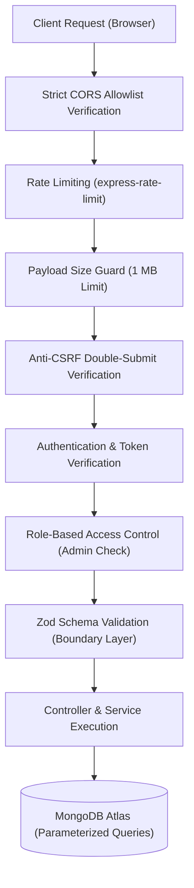

# Arcadia — Security Architecture & Threat Model

[← Back to Showcase Overview](../README.md) • [Architecture](ARCHITECTURE.md) • [System Design](SYSTEM_DESIGN.md) • [API Reference](API_REFERENCE.md) • [Deployment Runbook](DEVELOPMENT_AND_DEPLOYMENT.md)

---

This document outlines the security controls, defensive architecture, threat model, and vulnerability management strategy implemented across Arcadia.

---

## 1. Core Security Principles

Arcadia was architected with a defense-in-depth security posture designed to mitigate top web application risks outlined in the OWASP Top 10 (2021). The system balances responsive user interaction with strict server-side boundary validation.

---

## 2. Security Controls by Layer

### 2.1 Transport & Network Security
- **Strict HTTPS / TLS**: All communication between the client, API gateway, database, and external APIs is TLS 1.3/1.2 encrypted.
- **Strict CORS Origin Isolation**:
  - The API rejects requests with arbitrary or spoofed `Origin` headers.
  - Production deployments strictly validate incoming browser origins against an explicit, non-wildcard allowlist (`TRUSTED_ORIGINS`: `https://arcadia-two-ruby.vercel.app`, `https://arcadia-vantaeon.vercel.app`, and configured `FRONTEND_ORIGIN`).
  - Local development environments (`localhost`, `127.0.0.1`) are permitted conditionally only when `NODE_ENV !== 'production'`.
  - Non-browser requests (e.g., server-to-server health checks, monitoring probes) without an `Origin` header are permitted standard execution without CORS headers.

### 2.2 Authentication & Session Lifecycle
- **Stateless JWT with Database-Backed Token Versioning**:
  - Access tokens are signed using a high-entropy secret (`JWT_SECRET`) with configurable duration (`JWT_EXPIRES_IN`, default 7 days).
  - Rather than relying on heavy server-side session stores, Arcadia couples JWT claims with a database-backed `tokenVersion` counter.
  - **Single-Action Global Invalidation**: When a user changes their password, executes a logout, or is suspended by an administrator, the `tokenVersion` counter in their user record is atomically incremented. All previously issued tokens are rejected on their subsequent verification attempt.
- **Cookie Security & Double-Submit CSRF Protection**:
  - Authentication tokens are delivered via `HttpOnly`, `Secure`, and `SameSite` session cookies (`arcadia_session`).
  - In cross-origin production environments where the frontend resides on Vercel and the API on Render, cookies use `SameSite: None` with mandatory `Secure: true`.
  - All mutating HTTP requests (`POST`, `PUT`, `PATCH`, `DELETE`) are guarded by a double-submit Anti-CSRF token (`arcadia_csrf_token` cookie matched against `X-CSRF-Token` header).
- **Credential Storage**:
  - User passwords are processed using `bcryptjs` with a work factor (salt rounds) of 12.
  - Raw passwords are never persisted to disk, logged in diagnostic traces, or returned in API responses.
- **Rate Limiting**:
  - Unauthenticated auth routes (login, registration, password recovery) are throttled via `express-rate-limit` to 15 attempts per 15-minute window to prevent brute-force attacks and credential stuffing.

### 2.3 Access Control & Authorization (IDOR Defense)
- **Role-Based Access Control (RBAC)**:
  - Arcadia enforces two access tiers: `user` and `admin`.
  - Sensitive administrative endpoints (user suspension, bulk catalog flush, review moderation) are protected by dedicated route-level middleware (`requireRole('admin')`) that inspects both the authenticated user's verified role and active account status (`isBanned: false`).
- **Insecure Direct Object Reference (IDOR) Mitigation**:
  - All mutating endpoints (e.g., editing/deleting a review, toggling a game in a wishlist, updating personal library entries) explicitly verify resource ownership at the query level.
  - Operations query by both the resource identifier and the authenticated subject's `userId` (e.g., `{ _id: reviewId, userId: req.user._id }`), preventing privilege escalation where one user modifies or deletes another user's content.

### 2.4 Input Validation & Injection Prevention
- **Schema-Driven Boundaries**:
  - Every inbound HTTP request body and query parameter payload is validated using explicit Zod schemas before reaching business logic controllers.
  - Unexpected or malformed data properties are stripped or rejected with standard `400 Bad Request` validation envelopes.
- **NoSQL Injection Defense**:
  - Mongoose ODM and parameterized document queries prevent operator injection (e.g., `$gt`, `$ne` in raw query strings).
  - All query parameters are strictly cast to their expected primitive types (strings, numbers, booleans) during validation.
- **Denial of Service (DoS) Protections**:
  - Global payload limit: Inbound JSON payloads are strictly limited to `1 MB` via `express.json({ limit: '1mb' })`. Oversized payloads are intercepted and terminated with an HTTP `413 Payload Too Large` (`PAYLOAD_TOO_LARGE`) response before memory allocation.
  - API rate limiting: Authentication routes and public search endpoints are bounded to prevent resource exhaustion.

### 2.5 Administrative Safeguards & Bootstrap Hardening
- **Zero-Default Credentials**:
  - Administrative accounts cannot be created with insecure fallback passwords in production.
  - The CLI bootstrap utility (`seedAdmin.ts`) enforces strict configuration validation (`ADMIN_BOOTSTRAP_PASSWORD`, `ADMIN_BOOTSTRAP_EMAIL`). If bootstrap variables are absent or match known insecure defaults (e.g. `ChangeMeAdmin123!`, `admin`, `password`), the script immediately aborts with code `INSECURE_CONFIGURATION`.
  - In production environments, database seed scripts refuse to overwrite existing admin credentials unless explicit `--force` confirmation flags are provided.

---

## 3. Threat Model & Mitigations

| Threat Vector | Attack Scenario | Implemented Mitigation |
| :--- | :--- | :--- |
| **Broken Authentication** | Credential stuffing or token replay | 12-round bcrypt hashing, rate-limited auth endpoints (15 req/15 min), and `tokenVersion` counter for instant multi-device session revocation. |
| **Insecure Direct Object References (IDOR)** | User attempts to delete or edit another user's review or library item | Mutation queries enforce dual-predicate lookup (`_id` + `userId: req.user._id`). Ownership mismatch returns `403 Forbidden` / `404 Not Found`. |
| **Cross-Site Request Forgery (CSRF)** | Malicious third-party origin attempts to execute state changes | Strict CORS allowlist matching, `SameSite` cookie attributes, and double-submit Anti-CSRF token verification (`X-CSRF-Token`). |
| **NoSQL Injection** | Attacker injects MongoDB query operators in JSON body | Strict Zod validation parses and validates data types before query building; all database queries utilize Mongoose parameterized models. |
| **Denial of Service (Oversized Payloads)** | Attacker streams large JSON documents to exhaust API memory | Express body parser enforces a strict 1 MB limit, returning HTTP 413 `PAYLOAD_TOO_LARGE`. |
| **Privilege Escalation** | Standard user calls administrative maintenance or moderation routes | Dedicated `requireRole('admin')` middleware checks authenticated role, token version status, and `isBanned` flag. |
| **Data Scraping / Abuse** | Automated bots hammer third-party game data endpoints | Tiered rate limiting per IP on public and search routes; internal Mongoose caching layer minimizes upstream API hits. |

---

## 4. Security Verification & Test Suite

The security controls within Arcadia are validated automatically via comprehensive unit, integration, and security regression test suites executed across every pull request.

- **Automated Test Execution**:
  - **8 test suites** covering authentication, games catalog, user reviews, personal libraries, administrative controls, and system probes.
  - **121 passing tests** verifying both nominal execution and adversarial abuse cases (e.g., malformed tokens, expired sessions, payload overflows, IDOR attempts, and unauthorized admin access).
- **Static Analysis & Type Safety**:
  - Full TypeScript strict typechecking across all monorepo workspaces (`@arcadia/shared`, `@arcadia/api`, `@arcadia/web`).
  - Zero tolerance for unresolved type errors in CI pipelines.

---

## 5. Dependency Security & Known Backlog

As part of Arcadia's transparent engineering posture, third-party dependencies are continuously monitored against the GitHub Advisory Database and npm audit telemetry.

### Active Advisory Status

| Advisory ID | Package | Severity | Upstream Context & Remediation Status |
| :--- | :--- | :--- | :--- |
| **GHSA-mrhx-c7xc-m3w5** *(CVE-2023-54404)* | `zod@3.25.76` | Moderate | Affects schema recursion limits during adversarial parsing. Arcadia schemas do not utilize recursive or cyclic definitions. Scheduled for resolution with the upcoming migration to `zod@4.x`. |
| **GHSA-wrjc-x8rr-h8h6** **GHSA-337j-9hxr-rhxg** | `react-router@6.30.6` | Moderate | Affects specific server-side rendering (SSR) redirect handling. Arcadia's frontend is a client-side Single Page Application (SPA) deployed statically on Vercel; the affected SSR routing methods are not invoked. Migration to `react-router-dom@7.x` is scheduled on the frontend modernization roadmap. |

---

## 6. Vulnerability Disclosure Policy

We take the security of Arcadia and our users' data seriously. If you discover a vulnerability or security defect in Arcadia:

1. **Do not disclose publicly**: Please refrain from opening public GitHub issues or sharing exploit demonstrations publicly until the issue has been reviewed and addressed.
2. **Report Responsibly**: Send detailed vulnerability reports, steps to reproduce, and impact analysis to the project maintainers via private channel or security advisory inbox.
3. **Acknowledgment & Fix SLA**: Validated security reports receive an initial response within 48 business hours, and confirmed issues are prioritized for hotfix release.

---

[← Back to Showcase Overview](../README.md) • [Architecture](ARCHITECTURE.md) • [System Design](SYSTEM_DESIGN.md) • [API Reference](API_REFERENCE.md) • [Deployment Runbook](DEVELOPMENT_AND_DEPLOYMENT.md)
