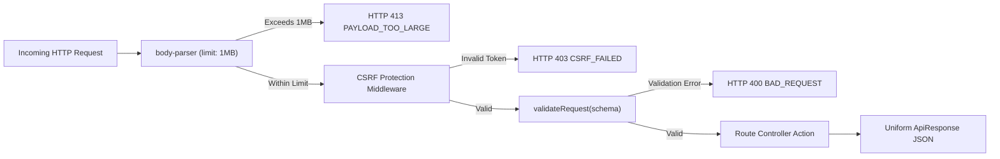

# Arcadia — System Design & Data Flow Documentation

[← Back to Showcase Overview](../README.md) • [Architecture](ARCHITECTURE.md) • [API Reference](API_REFERENCE.md) • [Security Overview](SECURITY_OVERVIEW.md) • [Deployment Runbook](DEVELOPMENT_AND_DEPLOYMENT.md)

---

This document details the internal system design, authentication lifecycle, session invalidation mechanisms, data ownership models, and error handling protocols implemented in Arcadia.

---

## 1. Authentication Lifecycle & Session Architecture

Arcadia employs a dual-defense authentication architecture combining cryptographically salted passwords (`bcryptjs` with 12 rounds) with stateless, tamper-evident JSON Web Tokens (JWT) stored in HTTP-only cookies alongside double-submit Anti-CSRF verification tokens.

```mermaid
sequenceDiagram
    autonumber
    actor User as Client Browser
    participant API as Express API Server
    participant DB as MongoDB Atlas

    Note over User,API: 1. Registration Flow
    User->>API: POST /api/v1/auth/register (email, password, displayName)
    API->>API: Validate with registerSchema (Zod)
    API->>DB: Check if email exists
    API->>API: bcrypt.genSalt(12) + bcrypt.hash(password)
    API->>DB: Create User document (role: 'user', tokenVersion: 0)
    API->>API: Sign JWT with userId & tokenVersion (JWT_EXPIRES_IN)
    API-->>User: 201 Created + Set-Cookie (arcadia_session; HttpOnly; Secure; SameSite=None)<br/>+ Set-Cookie (arcadia_csrf_token)

    Note over User,API: 2. Authenticated Request Flow
    User->>API: GET /api/v1/users/profile (Cookie: arcadia_session=...)
    API->>API: Verify JWT signature using JWT_SECRET
    API->>DB: Find user by ID
    API->>API: Compare tokenVersion: jwt.tokenVersion === user.tokenVersion
    alt Token Valid
        API-->>User: 200 OK + UserDto (passwordHash omitted)
    else Token Revoked / Version Mismatch
        API-->>User: 401 Unauthorized (Session Expired)
    end
```

### Instant Multi-Device Session Invalidation (`tokenVersion`)
- Each `User` document in MongoDB maintains an integer counter: `tokenVersion: { type: Number, default: 0 }`.
- When a JWT is generated, the current `tokenVersion` is embedded into the token's payload.
- Upon sensitive account operations—such as password changes, account suspension by an administrator, or explicit logout—the database `tokenVersion` is atomically incremented (`$inc: { tokenVersion: 1 }`).
- Subsequent requests bearing tokens with obsolete `tokenVersion` values are immediately rejected with HTTP 401, instantaneously revoking active sessions across all devices without requiring a centralized, stateful token blacklist.

---

## 2. Granular Data Ownership & IDOR Protection

Insecure Direct Object Reference (IDOR) vulnerabilities occur when an application relies on client-supplied identifiers to access database records without verifying ownership.

Arcadia enforces object-level access control on all user-specific collections:

1. **Personal Library & Wishlist Records:**
   - Every library mutation (`POST /api/v1/library/:gameId`, `PATCH /api/v1/library/:gameId`, `DELETE /api/v1/library/:gameId`) and wishlist action (`POST /api/v1/wishlist/:gameId`, `DELETE /api/v1/wishlist/:gameId`) extracts the owner's identity strictly from `req.user._id` populated by the verified session token.
   - Users cannot supply a foreign user ID to read, append, or delete records belonging to another account.
2. **Community Reviews:**
   - When a review is created via `POST /api/v1/games/:gameId/reviews`, the author's identity is bound directly to `req.user._id`. A compound index `{ gameId: 1, userId: 1 }` prevents duplicate reviews.
   - When a review is updated or deleted via `PUT /api/v1/reviews/:reviewId` or `DELETE /api/v1/reviews/:reviewId`, the controller verifies:
     ```typescript
     const isAuthor = review.userId.toString() === req.user._id.toString();
     const isAdmin = req.user.role === 'admin';
     if (!isAuthor && !isAdmin) {
       throw AppError.forbidden('You do not have permission to modify this review');
     }
     ```
   - Regular users can only edit or delete their own reviews; administrators possess moderation authority to remove inappropriate community submissions.

---

## 3. Administrative Control Plane & Audit Logging

Administrative endpoints (`/api/v1/admin/*`) are guarded by two sequential middleware layers:
1. `authenticate`: Verifies the session cookie and attaches the user document to `req.user`.
2. `requireRole('admin')`: Inspects `req.user.role`. If the role is not `'admin'`, an immediate HTTP 403 `FORBIDDEN` error is returned before any controller logic executes.

### Immutable Audit Trail
Every administrative mutation generates an immutable record in the `AuditLog` collection:

| Field | Type | Description |
| :--- | :--- | :--- |
| `actorId` | `ObjectId` | Unique identifier of the administrator executing the action |
| `actorEmail` | `String` | Email address of the administrative actor |
| `action` | `String` | Action category (e.g. `USER_ROLE_UPDATED`, `USER_STATUS_UPDATED`, `FEATURED_TOGGLED`, `CACHE_FLUSHED`, `ADMIN_BOOTSTRAP`) |
| `targetType` | `String` | Type of entity modified (`User`, `GameCache`, `Review`) |
| `targetId` | `String` | Identifier of the affected entity |
| `metadata` | `Object` | Contextual details (previous role, new role, ban status, timestamp) |
| `ipAddress` | `String` | Client IP address recorded during the administrative action |
| `userAgent` | `String` | Browser user-agent recorded during the administrative action |

Audit log records cannot be edited or deleted through the API gateway.

---

## 4. Input Validation & Error Handling Pipeline

All incoming HTTP requests pass through schema-driven validation middleware before reaching route controllers:



### Uniform API Response Envelope
All API responses follow a predictable TypeScript schema defined in `@arcadia/shared`:

```typescript
// Successful Response
{
  "success": true,
  "data": { ... }
}

// Error Response
{
  "success": false,
  "error": {
    "code": "VALIDATION_ERROR",
    "message": "Validation error",
    "details": [
      { "field": "email", "message": "Please provide a valid email address" }
    ]
  }
}
```
This uniform envelope ensures client-side error handling is consistent, eliminates unhandled promise rejections, and prevents internal stack traces from leaking into production responses.

---

[← Back to Showcase Overview](../README.md) • [Architecture](ARCHITECTURE.md) • [API Reference](API_REFERENCE.md) • [Security Overview](SECURITY_OVERVIEW.md) • [Deployment Runbook](DEVELOPMENT_AND_DEPLOYMENT.md)
